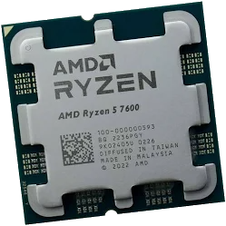

# Lab 3 — Teardown, and the same machine from the command line

Pair: Anuarhan + Ayanat · Date: 11/7/2026

## Part 1 — Ten parts

### 1. AMD Ryzen 5 7600

**Caption:** A desktop CPU with 6 cores and 12 threads. It connects to the AM5 socket on a compatible motherboard. It supports DDR5 memory. Its main limitation is that it cannot be installed in Intel or older AMD sockets.

**Manufacturer links:**
- https://www.amd.com/en/products/processors/desktops/ryzen/7000-series/amd-ryzen-5-7600.html
- https://www.amd.com/en/support/downloads/drivers.html/processors/ryzen/ryzen-7000-series/amd-ryzen-5-7600.html

### 2. Intel Core i5-13400

**Caption:** A desktop CPU with 10 cores and 16 threads. It connects to an LGA 1700 motherboard socket. It supports DDR4 or DDR5 memory, depending on the motherboard. Its main limitation is compatibility with LGA 1700 motherboards only.

**Manufacturer links:**
- https://www.intel.com/content/www/us/en/products/sku/230495/intel-core-i513400-processor-20m-cache-up-to-4-60-ghz/specifications.html
- https://www.intel.com/content/www/us/en/products/sku/230495/intel-core-i513400-processor-20m-cache-up-to-4-60-ghz/downloads.html

### 3. ASUS PRIME B650M-A

**Caption:** A Micro-ATX motherboard that connects the CPU, RAM, storage and other components. It has an AM5 socket, AMD B650 chipset and DDR5 memory support. It supports Ryzen 7000, 8000 and 9000 series processors, subject to BIOS compatibility. It cannot use Intel CPUs or DDR4 memory.

**Manufacturer links:**
- CPU support list: https://www.asus.com/motherboards-components/motherboards/prime/prime-b650m-a/helpdesk_qvl_cpu/
- Technical specifications: https://www.asus.com/motherboards-components/motherboards/prime/prime-b650m-a/techspec/

### 4. MSI PRO B760M-A WIFI DDR4

**Caption:** A Micro-ATX motherboard for Intel desktop processors. It connects the CPU, DDR4 RAM, storage and expansion cards. It uses the LGA 1700 socket and Intel B760 chipset. It supports compatible Intel Core 12th, 13th and 14th generation CPUs, subject to BIOS support. It cannot use DDR5 memory.

**Manufacturer links:**
- CPU support and downloads: https://www.msi.com/Motherboard/PRO-B760M-A-WIFI-DDR4/support
- Technical specifications: https://www.msi.com/Motherboard/PRO-B760M-A-WIFI-DDR4/Specification

### 5. Kingston FURY Beast DDR5-5600, 16 GB

**Caption:** A 16 GB DDR5 desktop memory module operating at 5600 MT/s. It connects to a 288-pin DDR5 DIMM slot on the motherboard. It temporarily stores data used by the CPU. It is not compatible with DDR4 motherboards.

**Manufacturer link:**
- https://www.kingston.com/en/memory/gaming/kingston-fury-beast-ddr5-memory

### 6. Crucial DDR4-3200, 16 GB DIMM

**Caption:** A 16 GB DDR4 desktop memory module operating at 3200 MT/s. It connects to a 288-pin DDR4 DIMM slot. It provides temporary storage for active programs and data. It cannot be installed in DDR5 motherboard slots.

**Manufacturer links:**
- https://www.crucial.com/memory/ddr4
- https://www.crucial.com/support

### 7. Samsung 990 PRO 1 TB

**Caption:** The Samsung 990 PRO is a high-performance 1 TB NVMe solid-state drive. It connects directly to an M.2 M-key slot on a compatible motherboard using the PCIe interface. It stores the operating system, applications and files. Its main limitation is that it requires a compatible M.2 NVMe slot and cannot connect directly to a SATA-only drive bay.

**Manufacturer links:**
- https://www.samsung.com/uk/memory-storage/nvme-ssd/990-pro-1tb-nvme-pcie-gen-4-mz-v9p1t0bw/
- Official Samsung datasheet: https://download.semiconductor.samsung.com/resources/data-sheet/Samsung_NVMe_SSD_990_PRO_Datasheet_Rev.1.0.pdf

### 8. Samsung 870 EVO 1 TB

**Caption:** The Samsung 870 EVO is a 1 TB SATA solid-state drive with a 2.5-inch form factor. It connects to the motherboard through a SATA data cable and receives power through a SATA power connector from the power supply. It stores files, applications and the operating system. Its main limitation is that its SATA interface is slower than modern NVMe PCIe SSDs.

**Manufacturer link:**
- https://www.samsung.com/us/memory-storage/sata-ssd/870-evo-sata-2-5-ssd-1tb-sku-mz-77e1t0b-am/

### 9. Corsair RM750e 750 W
.png>)

**Caption:** A 750 W ATX power supply that provides electricity to all computer components. It connects to the motherboard, CPU, graphics card and storage devices through power cables. Its limitation is its maximum 750 W output and physical compatibility with the computer case.

**Manufacturer links:**
- https://www.corsair.com/us/en/p/psu/cp-9020262-na/rme-series-rm750e-fully-modular-low-noise-atx-power-supply-cp-9020262-na
- Product manual: https://www.corsair.com/us/en/explorer/diy-builder/power-supply-units/rme-rm750e-power-supply-2023-instruction-manual/

### 10. Stock CPU Coolers

**Caption:** A stock CPU cooler removes heat from the processor using a heatsink and fan. It attaches to the motherboard's CPU mounting system and connects to the CPU_FAN header. The AMD Ryzen 5 7600 boxed version includes an AMD Wraith Stealth cooler. The boxed Intel Core i5-13400 includes an Intel Laminar RM1 cooler. Each cooler is designed for its compatible processor socket and thermal requirements.

**Manufacturer links:**

- AMD Ryzen 5 7600 specifications (lists Wraith Stealth): https://www.amd.com/en/products/processors/desktops/ryzen/7000-series/amd-ryzen-5-7600.html
- 
- Intel boxed processor contents (confirms the i5-13400 includes the Laminar RM1): https://www.intel.com/content/www/us/en/support/articles/000095154/processors.html
- Intel cooler installation and compatibility: https://www.intel.com/content/www/us/en/support/articles/000089627/processors.html

## The motherboards

### 1. ASUS PRIME B650M-A
* **Socket:** AMD Socket AM5
* **Chipset:** AMD B650
* **Memory:** DDR5, 4× DIMM slots (dual-channel, supports AMD EXPO profiles)
* **Storage connections:** 2× M.2 slots (Key M, type 2242/2260/2280 — 1× PCIe 5.0 x4, 1× PCIe 4.0 x4) and 4× SATA 6 Gb/s ports
* **Supported processor generations:** 
  * AMD Ryzen 7000 Series (supported out of the box).
  * AMD Ryzen 8000 and 9000 Series (requires a BIOS update).

### 2. MSI PRO B760M-A WIFI DDR4
* **Socket:** Intel Socket LGA 1700
* **Chipset:** Intel B760
* **Memory:** DDR4, 4× DIMM slots (dual-channel, supports Intel XMP profiles)
* **Storage connections:** 2× M.2 slots (Key M, type 2242/2260/2280 — both PCIe 4.0 x4) and 4× SATA 6 Gb/s ports
* **Supported processor generations:** 
  * 12th Gen Intel Core and 13th Gen Intel Core (supported out of the box).
  * 14th Gen Intel Core (requires a BIOS update).

## Two builds

### Build 1 — AMD Ryzen System

| Part        | Model                                | Why it fits here                                  |
| ----------- | ------------------------------------ | ------------------------------------------------- |
| CPU         | AMD Ryzen 5 7600                     | Uses the AM5 socket supported by the motherboard. |
| Motherboard | ASUS PRIME B650M-A                   | Supports Ryzen 7000 CPUs and DDR5 RAM.            |
| Memory      | Kingston FURY Beast DDR5-5600, 16 GB | Compatible with the motherboard's DDR5 slots.     |
| SSD         | Samsung 990 PRO 1 TB                 | Uses the motherboard's M.2 NVMe slot.             |
| PSU         | Corsair RM750e 750 W                 | Supplies enough power for this configuration.     |
| Cooler      | AMD Wraith Stealth                   | Compatible with the Ryzen 5 7600.                 |

### Build 2
### Build 2 — Intel System

| Part        | Model                     | Why it fits here                                   |
| ----------- | ------------------------- | -------------------------------------------------- |
| CPU         | Intel Core i5-13400       | Uses the LGA 1700 socket.                          |
| Motherboard | MSI PRO B760M-A WIFI DDR4 | Supports Intel 12th–14th generation CPUs and DDR4. |
| Memory      | Crucial DDR4-3200, 16 GB  | Compatible with the motherboard's DDR4 slots.      |
| SSD         | Samsung 870 EVO 1 TB      | Connects through the motherboard's SATA interface. |
| PSU         | Corsair RM750e 750 W      | Supplies power to all components.                  |
| Cooler      | Intel Laminar RM1         | Compatible with the boxed Intel processor.         |
What each build still needs:

Both computers need a PC case, monitor, keyboard, mouse and operating system. Additional case fans may be needed for proper airflow. A dedicated graphics card is optional because both processors have integrated graphics.

## Part 2 — Same facts, three operating systems

| Fact | Windows (PowerShell) | Linux (Ubuntu VM) | macOS |
| :--- | :--- | :--- | :--- |
| **CPU model** | `Get-CimInstance Win32_Processor` → Intel(R) Core(TM) i5-9300H CPU @ 2.40GHz | `lscpu` → Intel(R) Core(TM) i5-9300H CPU @ 2.40GHz | — |
| **Cores / threads** | `Get-CimInstance Win32_Processor` → 4 cores / 8 logical processors | `lscpu` → 2 cores / 2 threads (`CPU(s): 2`, 1 thread/core) | — |
| **Total memory** | `Get-CimInstance Win32_PhysicalMemory` → 8 GB (8589934592 bytes) | `free -h` → 3.2 GiB | — |
| **Memory modules and speed** | `Get-CimInstance Win32_PhysicalMemory` → 8 GB DDR4 @ 2400 MHz (SODIMM) | `sudo dmidecode -t memory` → Not exposed by VM (`SMBIOS 2.5 present`, no DIMM info) | — |
| **Disk model and type** | `Get-PhysicalDisk` → KINGSTON SA400S37480G (SSD, SATA) & NVMe SSD (128 GB) | `lsblk -d -o NAME,MODEL,ROTA,TRAN,SIZE` → `VBOX HARDDISK` (20G, SATA, `ROTA=1`) | — |
| **Free space** | `Get-Volume C` → Drive `C:` free / total space (see `windows-specs.txt`) | `df -h /` → 5.1G free out of 12G (`53%` used on `/`) | — |
| **Architecture (x86-64 / ARM64)** | `$env:PROCESSOR_ARCHITECTURE` → `AMD64` | `uname -m` → `x86_64` | — |

The operating systems use different names for the exact same hardware concepts: Windows calls the 64-bit architecture `AMD64` and reports `LogicalProcessors`, while Linux uses `x86_64` and `CPU(s)` *(no macOS machine was available in our pair)*. Inside the VirtualBox VM, Linux saw virtualized hardware rather than the host's physical parts: it showed only 2 CPU cores and 3.2 GiB of RAM instead of the host's 4 cores / 8 threads and 8 GB of RAM, hid physical DIMM speed in `dmidecode`, and reported a 20 GB `VBOX HARDDISK` with `ROTA=1` (rotational) even though the host uses physical SSDs.

## What did not work the first time

Transferring `linux-specs.txt` via `scp`:** Trying to copy from the VM's internal NAT IP (`10.0.2.15`) failed to connect from Windows, and omitting the port number caused a syntax error. Connecting through VirtualBox's forwarded localhost port (`scp -P 2222 yan@127.0.0.1:~/linux-specs.txt .`) transferred the file immediately.

## Evidence
- [evidence/windows-specs.txt](evidence/windows-specs.txt) — windows specs
- [evidence/linux-specs.txt](evidence/linux-specs.txt) — linux specs

