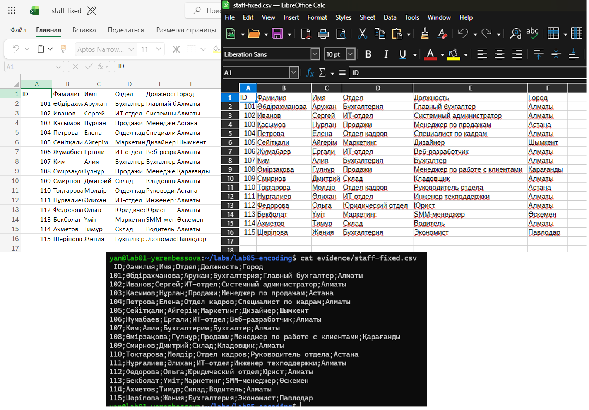

# Lab 5 — Encoding forensics

Name: Ayanat · Date: 10/11/2026 · Tools: Ubuntu guest but I connected it to PowerShell to make it easier for me to paste commands.

## What I received
### Excel
it reads Russian words correctly, but corrupts specific Kazakh letters


### LibreOffice
it automatically selects a Cyrillic encoding (Windows-1251) in the import dialog, which similarly results in the corruption of Kazakh characters.


### Terminal
white diamonds with question marks (�) appear in place of all Russian and Kazakh letters, as the terminal expects UTF-8 encoding.


## Diagnosis (made before the fix)
- file said: Non-ISO extended-ASCII text, with CRLF line terminators (evidence/file-before.txt)
- First 16 bytes: '4944 3bd4 e0ec e8eb e8ff 3bc8 ecff 3bce'  (evidence/hexdump-before.txt)
- Encoding: RK1048 — because each Cyrillic and Kazakh character is stored as a single byte 
- Line ending: CRLF — because the end of the header line in the hex dump (offset `00000024`) contains the bytes `0d 0a` right before `3130 313b` (`101;`)
- BOM: no — because the file starts directly with `49 44` instead of `ef bb bf`; in the fixed file I added it because Microsoft Excel on Windows requires the UTF-8 BOM (`EF BB BF`) to auto-detect UTF-8 when opened via double-click


## Fix
```
#!/bin/shh
# Lab 5: convert staff-broken.csv from <SOURCE> to UTF-8
in=evidence/staff-broken.csv
out=evidence/staff-fixed.csv
iconv -f <SOURCE> -t UTF-8 "$in" > "$out"        # 1. encoding
# 2. line endings — keep ONE of these lines:
# sed -i 's/\r$//' "$out"                         #    CRLF -> LF
# sed -i 's/$/\r/' "$out"                         #    LF -> CRLF (only if the source was LF)
# 3. BOM — only if you decided to add one:
```

## Verification
Output of `file evidence/staff-fixed.csv` :** `Unicode text, UTF-8 (with BOM) text, with CRLF line terminators`. The file now starts with the UTF-8 BOM bytes `efbb bf` followed by `49 44 3b` (`ID;`) and standard two-byte UTF-8 sequences instead of single-byte RK1048 characters.


## What did not work the first time
When running commands to save `evidence/file-after.txt`, I initially executed them from the home directory (`~`) instead of `~/labs/lab05-encoding`, resulting in `No such file or directory` until I navigated into the lab folder with `cd`.
