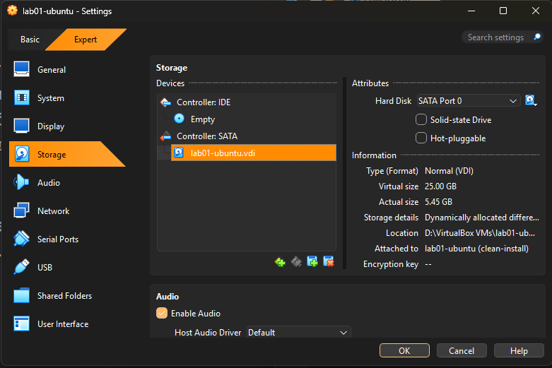
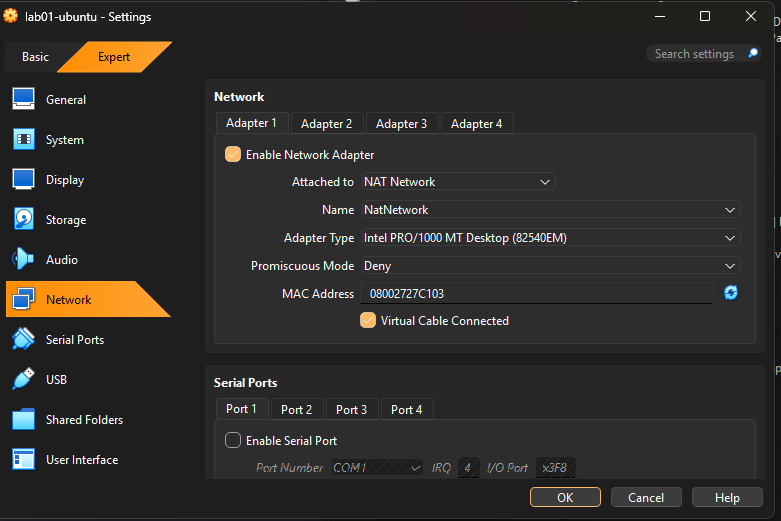
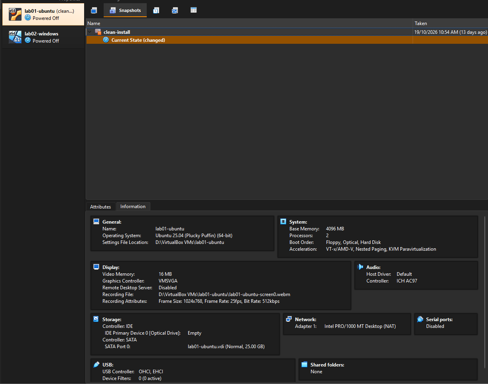

# BUILD.md - Step-by-Step Deployment Guide for Office Manager

This document provides a simple, foolproof guide to rebuilding the isolated development environment containing both Linux and Windows guest operating systems from scratch.

---

## Step 1. Initial Virtual Machine Setup
Open Oracle VirtualBox, click the **New** button, and set up the base parameters for the Ubuntu Server. Give it a clear name (e.g., `lab01-ubuntu`), choose Linux as the type, and Ubuntu (64-bit) as the version. Allocate **4096 MB (4 GB)** of RAM and **2 CPU cores**.

* **Why this option:** Allocating 4 GB of RAM and 2 CPUs ensures smooth execution of development scripts and server tools without causing heavy stuttering on your office laptop.
* **Check:** Once you complete the wizard, the new virtual machine container will appear in the left-hand list of your VirtualBox manager.

---

## Step 2. Configuring Virtual Hard Storage
During the hard disk setup phase in the wizard, choose to create a virtual hard disk now and ensure its allocation type is strictly set to **Dynamically allocated** with a size limit of **25.00 GB**.

* **Why this option:** A dynamically allocated disk grows incrementally only as files are written to it. It prevents VirtualBox from immediately locking up 25 GB of your physical drive space, leaving room for your host operating system to run comfortably.
* **Check:** Right-click the VM, go to Settings -> Storage, click on the `.vdi` file, and verify that the "Storage Type" displays "Dynamically allocated".

---

## Step 3. Configuring Local Network Isolation
Right-click your virtual machine, navigate to **Settings**, open the **Network** tab, and set the "Attached to" option to **NAT**.

* **Why this option:** The office environment network blocks unrecognized physical MAC addresses. Using NAT allows the guest machine to safely route through your laptop's active network connection to hit the internet, masking the virtual machine behind your host IP address.
* **Check:** Start the VM, open the terminal, and type `ip addr`. You should see an internal network address assigned to the guest interface (e.g., 10.0.2.15).

---

## Step 4. Establishing a Clean Safety Point (Snapshots)
Before handing the configured test machine over to the new developer, navigate to the **Snapshots** section of the virtual machine within the VirtualBox UI, and click **Take** to capture the system status. Name it `clean-install`.

* **Why this option:** If the developer accidentally breaks a configuration or corrupts the operating system environment ("without breaking the host"), you can open this tab, click on `clean-install`, and hit **Restore**. This reverts the environment to a completely pristine state in 5 seconds.
* **Check:** A new node named `clean-install` will be visible in the Snapshot tree overview for that specific machine.

