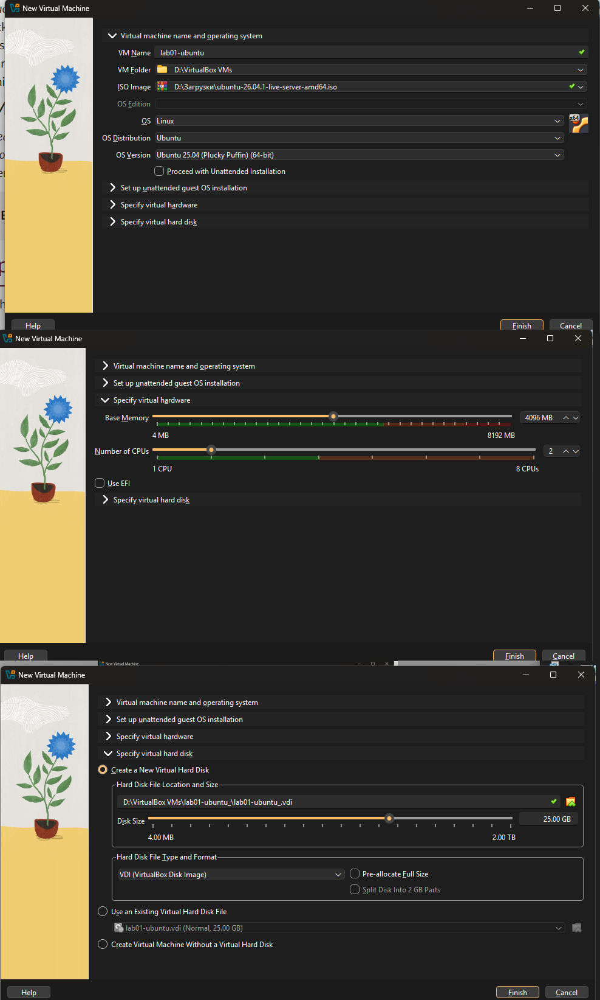

## Step 1. Creating the Virtual Machine Base
Open VirtualBox, click **New**, and specify the name, operating system type, and resources. Allocate 2 GB of RAM and 1 CPU core for the Ubuntu Server guest.

**Why these resources:** 2 GB of RAM and 1 CPU core are the minimum requirements for a stable Ubuntu Server command-line interface. This ensures the developer can run light test applications without consuming too much of the host machine's performance.

> Check: After clicking "Next", the VM should appear in the left-hand list of your VirtualBox manager.

